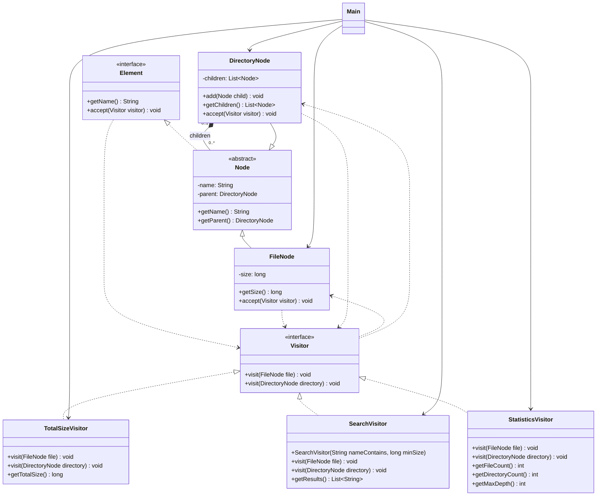

# Assignment 6 | Visitor

- **Name:** Alikhan Smagul
- **Group:** SE-2529
- **Repository:** https://github.com/alihzzz/SDP_Assignment6.git


## Idea
A file system contains files and directories. We may need to calculate the total
file size, search for files, or collect statistics about the tree.
Putting all these operations into the node classes makes them hard to extend.
Each operation is moved into its own visitor, and each node accepts a visitor
through `accept()`. The node calls the matching `visit()` method, and the visitor
handles the operation and traverses the directory's children:

```java
TotalSizeVisitor sizeVisitor = new TotalSizeVisitor();
root.accept(sizeVisitor);
System.out.println(sizeVisitor.getTotalSize());
```

`TotalSizeVisitor` calculates the total file size. `SearchVisitor` finds files
whose names contain a given string and whose sizes meet a minimum value.
`StatisticsVisitor` counts files and directories and finds the maximum depth.

## Structure
```
src/
  main/java/fs/
    Element.java, Node.java, FileNode.java, DirectoryNode.java
    Visitor.java, TotalSizeVisitor.java, SearchVisitor.java, StatisticsVisitor.java
    Main.java
  test/java/fs/
    TestTree.java, DispatchTest.java, TreeIntegrityTest.java
    TotalSizeVisitorTest.java, SearchVisitorTest.java, StatisticsVisitorTest.java
```

## UML class diagram


## How to add a new visitor
1. Create a class in `src/main/java/fs/` that implements `Visitor`.
2. Implement `visit(FileNode file)` and `visit(DirectoryNode directory)`.
3. In the directory method, iterate over `directory.getChildren()` and call
   `child.accept(this)` to visit the whole subtree.
4. In `Main`, create the visitor and call `root.accept(new YourVisitor());`.

The existing node classes do not need to be changed.

## How to run
Requires JDK 17 or newer. Run from the project root:

```
javac -d out src/main/java/fs/*.java
java -cp out fs.Main
```
Or open the folder in IntelliJ IDEA and run `fs.Main`.